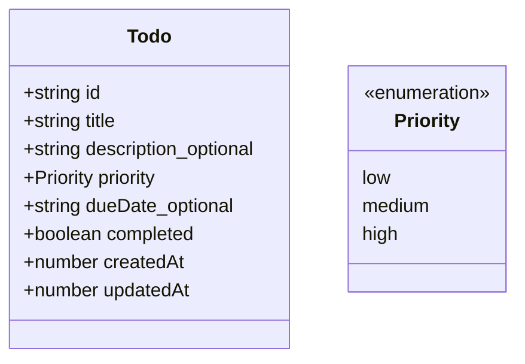

# Todo App — Feature Specification

เอกสารข้อกำหนดฟีเจอร์และพฤติกรรมของ Smart Todo โดยยึด Data Model และเงื่อนไขจากสเปกอาจารย์

## 1. Data Model: Task

```ts
type Priority = "low" | "medium" | "high";
type FilterStatus = "all" | "active" | "completed";
type FilterPriority = "all" | Priority;

interface Todo {
    id: string;
    title: string;
    description?: string;
    priority: Priority;
    dueDate?: string;
    completed: boolean;
    createdAt: number;
    updatedAt: number;
}
```

| Field | Required | กฎ/รายละเอียด |
| --- | --- | --- |
| `id` | ใช่ | string ที่ไม่ซ้ำ; สร้างเป็น UUID หรือ timestamp |
| `title` | ใช่ | string; trim แล้วต้องไม่ว่าง และมีความยาว 1–100 ตัวอักษร |
| `description` | ไม่ | string สำหรับรายละเอียดสั้น ๆ |
| `priority` | ใช่ | รับเฉพาะ `low`, `medium`, `high` |
| `dueDate` | ไม่ | ISO date string หรือ `YYYY-MM-DD`; อนุญาตให้ไม่ระบุ |
| `completed` | ใช่ | boolean; `false` คือ Active, `true` คือ Done |
| `createdAt` | ใช่ | number timestamp; กำหนดด้วย `Date.now()` เมื่อสร้าง task |
| `updatedAt` | ใช่ | number timestamp; ตั้งตอนสร้าง task และเปลี่ยนทุกครั้งที่แก้ข้อมูล task |

task ใหม่ต้องมี `completed: false` และค่า priority ที่ถูกต้อง UI แสดง Active/Done และขีดฆ่าชื่องานเมื่อ Done

### Data Model Diagram



### Due Date Behavior

| ค่า `dueDate` | พฤติกรรม |
| --- | --- |
| ไม่ระบุ / `null` | อนุญาตให้บันทึก task ได้ ไม่แสดงวันกำหนดส่งในรายการ และไม่นับว่าเลยกำหนด |
| วันที่วันนี้หรืออนาคต (`YYYY-MM-DD`) | อนุญาตให้บันทึก และแสดงเป็นวันที่อ่านง่าย |
| วันที่ผ่านมา (`YYYY-MM-DD`) | อนุญาตให้บันทึกและแสดงวันที่ พร้อมระบุว่าเลยกำหนดเมื่อ task ยังไม่ Done |
| รูปแบบไม่ถูกต้องหรือไม่มีวันที่จริง | ไม่อนุญาตให้เพิ่ม task และแจ้ง validation error |

วันที่เลยกำหนดไม่เปลี่ยน `completed` โดยอัตโนมัติ; สถานะยังเปลี่ยนด้วยการกระทำของผู้ใช้เท่านั้น

## 2. Search

- รับ keyword จาก input ของผู้ใช้
- แปลง keyword และ `title`/`description` เป็น lower case เพื่อค้นหาโดยไม่สนตัวพิมพ์เล็ก/ใหญ่
- ค้นหาเฉพาะ `title` หรือ `description`
- keyword ว่างหรือมีแต่ช่องว่างไม่กรองรายการเพิ่ม แต่ยังใช้ status/priority filter ที่เลือกอยู่
- รายการปัจจุบันมีขนาดเล็ก จึงค้นหาทันทีโดยไม่ใช้ debounce; พิจารณา debounce เช่น 300 ms เมื่อข้อมูลมีจำนวนมาก

## 3. Filter

### Status

- `all`: แสดงทุกสถานะ
- `active`: แสดงเฉพาะ `completed === false`
- `completed`: แสดงเฉพาะ `completed === true`

### Priority

- `all`: แสดงทุกระดับ
- `high`: แสดงเฉพาะ priority สูง
- `medium`: แสดงเฉพาะ priority ปานกลาง
- `low`: แสดงเฉพาะ priority ต่ำ

### เงื่อนไขร่วม

- รวม Search Keyword, Status Filter และ Priority Filter ด้วยตรรกะ AND
- แสดงจำนวน task ที่ตรงกับเงื่อนไขทั้งหมด
- เมื่อไม่มี task ที่ตรง ให้แสดงข้อความ empty state เช่น “ไม่พบรายการที่ตรงกับเงื่อนไขการค้นหาหรือตัวกรอง”

## 4. Core Features

1. Task มี title และ description แบบไม่บังคับ
2. Priority ใช้ `low` / `medium` / `high` และแสดง badge แยกตามระดับ
3. Due Date ใช้ระบุวันกำหนดเสร็จและแสดงในรูปแบบที่อ่านง่าย
4. Status เก็บเป็น `completed: boolean`; UI แสดง Active หรือ Done
5. ผู้สอนสาธิต Search/Filter หลังจบ CP5

## 5. Acceptance Criteria

| ID | เกณฑ์ | ผลที่คาดหวัง |
| --- | --- | --- |
| AC-01 | Title ว่างหรือมีแต่ whitespace | เพิ่ม task ไม่ได้ และแจ้งเตือนหรือปิดการเพิ่ม |
| AC-02 | Toggle status | สลับ Active/Done ได้ และเปลี่ยนเฉพาะ task ที่เลือก |
| AC-03 | Keyword Search | รายการกรองจาก title/description โดยไม่สนตัวพิมพ์เล็ก/ใหญ่ |
| AC-04 | Priority Filter | เลือก all/high/medium/low ได้ถูกต้อง |
| AC-05 | Readable Due Date | แสดงวันในรูปแบบอ่านง่าย ไม่แสดง raw date string |
| AC-06 | Combined filters | Search, status และ priority ทำงานร่วมกันด้วย AND |
| AC-07 | Match counter | จำนวนตรงกับรายการที่แสดงหลังกรอง |
| AC-08 | Empty state | เมื่อไม่มีผลลัพธ์ แสดงข้อความแจ้งว่าไม่พบรายการตามเงื่อนไข |

## 6. Component Mapping

```text
App
├── TodoForm (title, description, priority, dueDate)
├── TodoFilter (search, status และ priority filters)
└── TodoList (ผลลัพธ์และ empty state)
    └── TodoItem (checkbox, title, priority badge, dueDate, actions)
```

`App` เป็นเจ้าของ tasks state; child ส่ง event ผ่าน callbacks และไม่แก้ state โดยตรง
